<!-- cards:hero:start -->

<!-- cards:hero:end -->

I'm the **Tech Lead at Port Promotora**, a fintech building financial products for the Brazilian credit market, and an Information Systems student at the **Federal Rural University of Pernambuco (UFRPE)**.

---

## 💻 About Me

I'm a full-stack developer who works mostly on modern web applications and **RPA**, with hands-on **DevOps** experience on the side. I care about building fast, responsive products that people actually enjoy using, and I'm always learning the next tool that helps a team ship better. Off the clock, I'm usually deep in some sci-fi.

---

## 🚀 Experience

- **Port Promotora**, Tech Lead: I lead the technical development of scalable platforms for credit operations.
- **Lojas Quero Quero** *(previously)*: I built internal automation tools and helped rebuild the company's credit renegotiation website from the ground up.
- **Seed a Bit** *(previously)*: I worked on client websites, including Seed a Bit's own site and Emiliane Alencastro's.

---

## 📫 Get in Touch

<!-- cards:contact:start -->

  

<!-- cards:contact:end -->

---

## 🖥️ Tech Stack

---

## 📈 GitHub Activity

<!-- cards:activity:start -->

<!-- cards:activity:end -->
